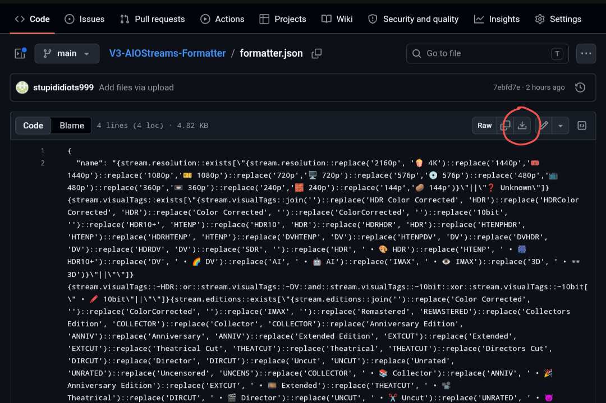
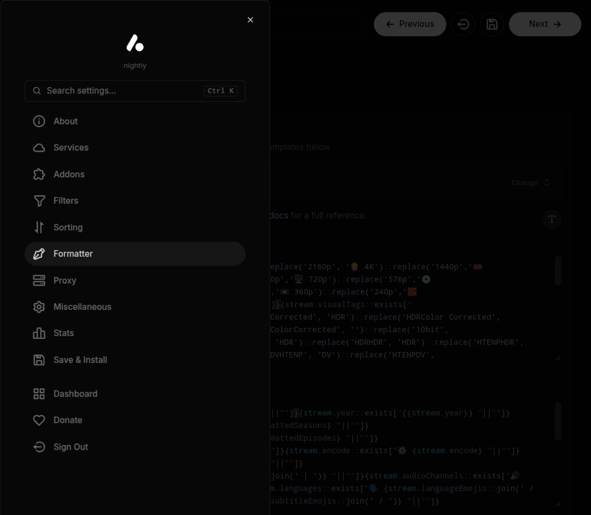
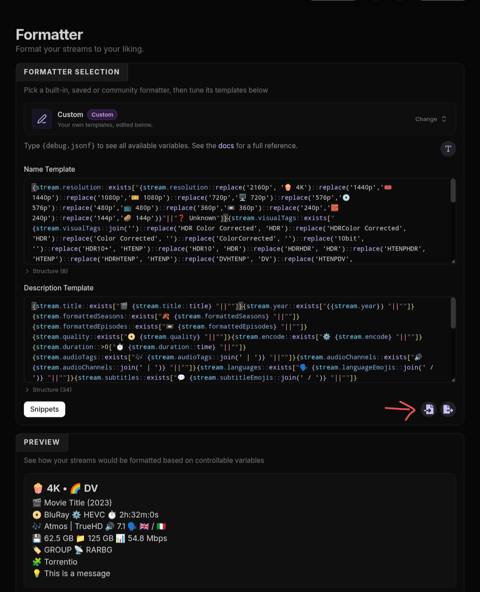
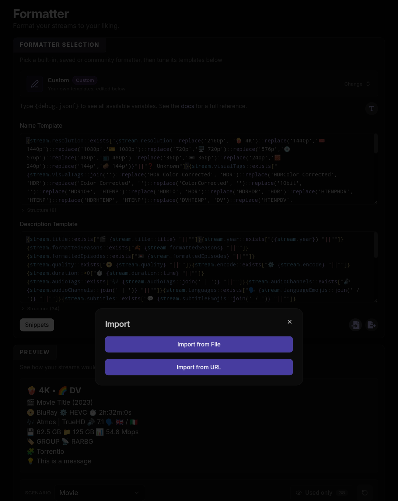

<div align="center">

# ✨ V3 AIOStreams Formatter


*A cleaner, smarter, minimalistic AIOStreams formatter with emojis. Automatically detects Open Matte & special editions, hides redundant tags and smartly displays filenames for AI/unknown streams.*

</div>

---

## 📸 Previews

*(Screenshots of V3 formatting in action)*

<div align="center">
  
  
  
  
  
  
  
</div>

---

## 🎨 Emoji & Tag Reference

### 🏷️ Name Template Tags

| Category | Output Format & Emojis | Smart Logic / Behavior |
| :--- | :--- | :--- |
| **Resolutions** | `🍿 4K` · `🎟️ 1440p` · `🎫 1080p` · `🖥️ 720p` · `💿 576p` · `📺 480p` · `📼 360p` · `🧱 240p` · `🥔 144p` · `❓ Unknown` | Converts `2160p` to `🍿 4K`; falls back to `❓ Unknown` if missing |
| **HDR Hierarchy** | `🌈 DV` **>** `🎆 HDR10+` **>** `🎨 HDR` | Deduplicates tags so only the highest dynamic range format displays |
| **IMAX & Formats** | `👁️ IMAX` · `🖼️ Open Matte` · `👓 3D` · `🤖 AI` | Displays `👁️ IMAX` from visual tags and strips duplicates from editions |
| **Bit Depth** | `🖍️ 10bit` | **SDR-only** — automatically hidden when `🌈 DV` or `🎨 HDR` is present |
| **Cuts & Editions** | `🎬 Director` · `🎞️ Extended` · `📽️ Theatrical` · `🪄 Remastered` · `📚 Collector` · `🎉 Anniversary Edition` | Normalizes naming variations (e.g., *Director's Cut* → `🎬 Director`) |
| **Release Flags** | `✂️ Uncut` · `😈 Unrated` · `🌶️ Uncensored` · `🖌️ Regraded` | Scans edition tags and stream flags; strips `Color Corrected` |

### 📝 Description Template Layout

| Line | Template Output | Included Metadata |
| :--- | :--- | :--- |
| **Line 1** | `🎬 Title (Year) 🍂 S01 📼 E01` | Stream Title, Release Year, Formatted Seasons & Episodes |
| **Line 2** | `📀 Quality ⚙️ Encode ⏱️ Duration` | Source Quality (BluRay, WEB-DL), Codec (HEVC, AV1), Runtime |
| **Line 3** | `🎶 Audio 🔊 Channels 🗣️ Lang 💬 Subs` | Audio Formats (`\|` separated), Channels, Audio & Subtitle Flag Emojis |
| **Line 4** | `💾 Size 📁 Folder 📊 Bitrate 🌱 Seeds 🕰️ Age` | File/Folder Size, Bitrate, Seeders (P2P/Uncached), Post Age (Usenet) |
| **Line 5** | `🏷️ Group 📡 Indexer 🎭 Network` | Release Group, Indexer Name, Broadcast/Streaming Network |
| **Line 6** | `⚡ Ready (Service) 📌 Library 🔗 Type 🧩 Addon` | Cache (`⚡ Ready` / `❌ Not Ready`), Type (`☁️ Usenet`, `🔗 P2P`, `🌍 Web Link`, `🟥 Youtube`, `📡 Live`), `🛡️ Proxied`, `🕵️ Private`, Addon |
| **Line 7–8** | `💡 Message` / `📄 Filename` | Addon Message & Smart Filename Fallback (`🤖 AI` or `❓ Unknown` res) |

---


## 🏷️ Name Template Changes in V3

### 🧠 Smart 10-bit Logic
The `10bit` tag (🖍️) is now dynamically hidden if HDR or Dolby Vision is already detected. It will only display for 10-bit SDR files, keeping your titles uncluttered and avoiding redundant information.

### 🖼️ Open Matte Detection
Actively scans file and folder names for multiple variations of "Open Matte" (e.g., `Open.Matte`, `openmatte`) and automatically flags them with: ` • 🖼️ Open Matte`

### 🧹 Cleaner Display & ↔️ Dynamic Spacing
Redundant text like "Color Corrected" is automatically filtered out. Hardcoded spacing gaps are removed—the spacing is built right into the replacement (e.g., formatting HDR as ` • 🎨 HDR`). If a tag doesn't exist, its extra space is completely removed, ensuring a perfectly clean line every time.

### 🎬 Expanded Edition Tags
Added advanced detection and custom emojis for several missing editions: 🪄 **Remastered** | 📚 **Collector’s** | 🎉 **Anniversary** | ✂️ **Uncut** | 😈 **Unrated** | 🌶️ **Uncensored**

---

## 📝 Description Template Changes in V3

### 📉 Decluttered Title Line
Completely removed the Seadex and RSE tiering logic (🎚️ Best, T1-T8). The top line now strictly focuses on the **Title**, **Year**, **Seasons**, and **Episodes** for a much cleaner, easier-to-read look.

### 📄 Smart Filename Display
The description automatically shows the raw filename (`📄 {stream.filename}`) at the very bottom in **two specific situations** to give you better context:
1. **For "AI" Releases:** "AI" is a broad term—it could mean AI-upscaled, AI 60fps interpolation, or an AI-generated Open Matte. Printing the filename is the easiest way to let you see exactly what you are clicking on.
2. **For Unknown Resolutions:** When a file is missing a resolution tag, the filename often holds the missing visual clues (like DV or HDR). Glancing at the raw filename for those clues lets you safely conclude it must be a 4K release.

---

## 🔗 Installation

There are three ways to apply this formatting to your AIOStreams setup:

### Main Method: Copy & Paste
Copy the large text blocks below and manually paste them into the Name Template and Description Template fields in AIOStreams formatter page.

**Step 1:** Open your AIOStreams settings and click on **Formatter** in the left sidebar.
<br>

<br><br>

**Step 2:** Click on the drop down menu and select **Custom**.
<br>

<br><br>

**Step 3:** Copy Paste into respective fields 

**Name Template:**
```text
{stream.resolution::exists["{stream.resolution::replace('2160p', '🍿 4K')::replace('1440p','🎟️ 1440p')::replace('1080p','🎫 1080p')::replace('720p','🖥️ 720p')::replace('576p','💿 576p')::replace('480p','📺 480p')::replace('360p','📼 360p')::replace('240p','🧱 240p')::replace('144p','🥔 144p')}"||"❓ Unknown"]}{stream.visualTags::exists["{stream.visualTags::join('')::replace('HDR Color Corrected', 'HDR')::replace('HDRColor Corrected', 'HDR')::replace('Color Corrected', '')::replace('ColorCorrected', '')::replace('10bit', '')::replace('HDR10+', 'HTENP')::replace('HDR10', 'HDR')::replace('HDRHDR', 'HDR')::replace('HTENPHDR', 'HTENP')::replace('HDRHTENP', 'HTENP')::replace('DVHTENP', 'DV')::replace('HTENPDV', 'DV')::replace('DVHDR', 'DV')::replace('HDRDV', 'DV')::replace('SDR', '')::replace('HDR', ' • 🎨 HDR')::replace('HTENP', ' • 🎆 HDR10+')::replace('DV', ' • 🌈 DV')::replace('AI', ' • 🤖 AI')::replace('IMAX', ' • 👁️ IMAX')::replace('3D', ' • 👓 3D')}"||""]}{stream.visualTags::~HDR::or::stream.visualTags::~DV::and::stream.visualTags::~10bit::xor::stream.visualTags::~10bit[" • 🖍️ 10bit"||""]}{stream.editions::exists["{stream.editions::join('')::replace('Color Corrected', '')::replace('ColorCorrected', '')::replace('IMAX', '')::replace('Remastered', 'REMASTERED')::replace('Collectors Edition', 'COLLECTOR')::replace('Collector', 'COLLECTOR')::replace('Anniversary Edition', 'ANNIV')::replace('Anniversary', 'ANNIV')::replace('Extended Edition', 'EXTCUT')::replace('Extended', 'EXTCUT')::replace('Theatrical Cut', 'THEATCUT')::replace('Theatrical', 'THEATCUT')::replace('Directors Cut', 'DIRCUT')::replace('Director', 'DIRCUT')::replace('Uncut', 'UNCUT')::replace('Unrated', 'UNRATED')::replace('Uncensored', 'UNCENS')::replace('COLLECTOR', ' • 📚 Collector')::replace('ANNIV', ' • 🎉 Anniversary Edition')::replace('EXTCUT', ' • 🎞️ Extended')::replace('THEATCUT', ' • 📽️ Theatrical')::replace('DIRCUT', ' • 🎬 Director')::replace('UNCUT', ' • ✂️ Uncut')::replace('UNRATED', ' • 😈 Unrated')::replace('UNCENS', ' • 🌶️ Uncensored')::replace('REMASTERED', ' • 🪄 Remastered')}"||""]}{stream.regraded::istrue[" • 🖌️ Regraded"||""]}{stream.uncensored::istrue[" • 🌶️ Uncensored"||""]}{stream.unrated::istrue[" • 😈 Unrated"||""]}{stream.folderName::~Open Matte::or::stream.folderName::~Open.Matte::or::stream.folderName::~OpenMatte::or::stream.folderName::~open matte::or::stream.folderName::~open.matte::or::stream.folderName::~openmatte::or::stream.filename::~Open Matte::or::stream.filename::~Open.Matte::or::stream.filename::~OpenMatte::or::stream.filename::~open matte::or::stream.filename::~open.matte::or::stream.filename::~openmatte[" • 🖼️ Open Matte"||""]}
```

**Description Template:**
```text
{stream.title::exists["🎬 {stream.title::title} "||""]}{stream.year::exists["({stream.year}) "||""]}{stream.formattedSeasons::exists["🍂 {stream.formattedSeasons} "||""]}{stream.formattedEpisodes::exists["📼 {stream.formattedEpisodes} "||""]}
{stream.quality::exists["📀 {stream.quality} "||""]}{stream.encode::exists["⚙️ {stream.encode} "||""]}{stream.duration::>0["⏱️ {stream.duration::time} "||""]}
{stream.audioTags::exists["🎶 {stream.audioTags::join(' | ')} "||""]}{stream.audioChannels::exists["🔊 {stream.audioChannels::join(' | ')} "||""]}{stream.languages::exists["🗣️ {stream.languageEmojis::join(' / ')} "||""]}{stream.subtitles::exists["💬 {stream.subtitleEmojis::join(' / ')} "||""]}
{stream.size::>0["💾 {stream.size::sbytes} "||""]}{stream.folderSize::>0["📁 {stream.folderSize::sbytes} "||""]}{stream.bitrate::>0["📊 {stream.bitrate::sbitrate} "||""]}{service.cached::isfalse::or::stream.type::=p2p::and::stream.seeders::>0["🌱 {stream.seeders} "||""]}{stream.type::=usenet::and::stream.age::exists["🕰️ {stream.age} "||""]}
{stream.releaseGroup::exists["🏷️ {stream.releaseGroup} "||""]}{stream.indexer::exists["📡 {stream.indexer} "||""]}{stream.network::exists["🎭 {stream.network} "||""]}
{service.cached::istrue["⚡ Ready "||""]}{service.cached::isfalse["❌ Not Ready "||""]}{service.id::exists["({service.shortName}) "||""]}{stream.library::istrue["📌 Library "||""]}{stream.type::=Usenet["☁️ Usenet "||""]}{stream.type::=p2p["🔗 P2P "||""]}{stream.type::=http["🌍 Web Link "||""]}{stream.type::=youtube["🟥 Youtube "||""]}{stream.type::=live["📡 Live "||""]}{stream.proxied::istrue["🛡️ Proxied "||""]}{stream.private::istrue["🕵️ Private "||""]}🧩 {addon.name} 
{stream.message::exists["💡 {stream.message}"||""]}
{stream.resolution::exists[""||"📄 {stream.filename}"]}{stream.visualTags::~AI["📄 {stream.filename}"||""]}
```

<br>

### Pastebin Links:

[](https://pastebin.com/raw/XPehQTCV) 
```text
https://pastebin.com/raw/XPehQTCV
```

[](https://pastebin.com/raw/n2WPg8Sf)
```text
https://pastebin.com/raw/n2WPg8Sf
```

---

### Secondary Method: Direct File Import
Download the [formatter.json](formatter.json) file from this repository to automatically apply all the formatting for you!

**How To:** Click on the **formatter.json** above and then hit the download button in the top right corner..
<br>

<br><br>

**Step 1:** Open your AIOStreams settings and click on **Formatter** in the left sidebar.
<br>

<br><br>

**Step 2:** Look for the two small icons under the template boxes. Click the **Import** icon (the one with the arrow pointing *into* the file).
<br>

<br><br>

**Step 3:** Click **Import from File** and select the `formatter.json` file you downloaded. Everything will instantly populate!
<br>

<br><br>

---

## 🙏 Support & Previous Versions

If you found this helpful or useful, I would really appreciate it if you used my Torbox referral link/code! 😊

[](https://torbox.app/subscription?referral=58849a2c-cef3-41aa-8f4e-5cd3678a73c8) 

**Referral Link:**
```text
https://torbox.app/subscription?referral=58849a2c-cef3-41aa-8f4e-5cd3678a73c8
```

**Referral Code:** 
```text
58849a2c-cef3-41aa-8f4e-5cd3678a73c8
```

### 🕰️ History
Looking for the older versions? 
* [V2 Reddit Release](https://www.reddit.com/r/aiostreams/s/57tEjA2kR5)
* [V1 Reddit Release](https://www.reddit.com/r/aiostreams/s/D9z3NAocUP)
